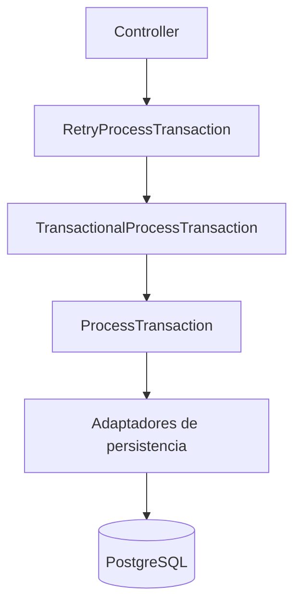
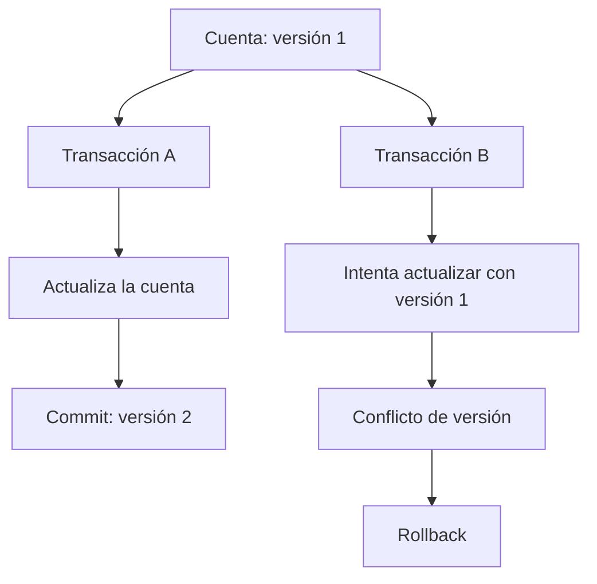
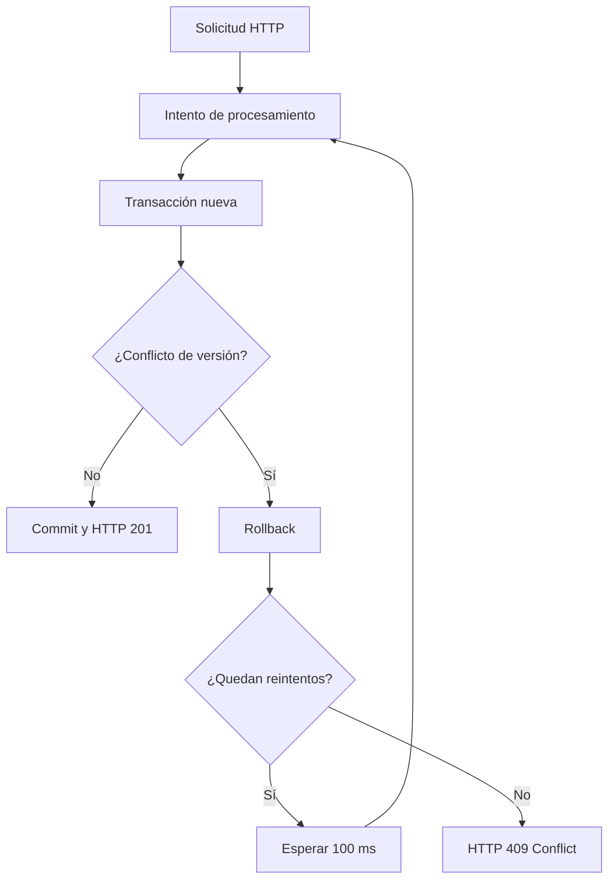

# Laboratorio de concurrencia y paralelismo en Java

Laboratorio práctico de Java 21 y Spring Boot orientado a comprender distintas formas de ejecutar
trabajo, identificar cuándo conviene utilizarlas y observar su comportamiento mediante métricas.

El proyecto utiliza escenarios financieros acotados para estudiar cuatro enfoques:

| Enfoque                          | Escenario de estudio                 | Propósito                                                                        |
|----------------------------------|--------------------------------------|----------------------------------------------------------------------------------|
| Ejecución secuencial             | Procesamiento de transacciones       | Respetar dependencias y el orden de las operaciones.                             |
| `CompletableFuture`              | Obtención de datos de mercado        | Coordinar operaciones de entrada/salida independientes.                          |
| Procesamiento paralelo CPU-bound | Análisis de transacciones históricas | Distribuir cálculos intensivos entre recursos de procesamiento.                  |
| Virtual threads                  | Consultas financieras concurrentes   | Atender numerosas tareas de entrada/salida con un modelo de concurrencia ligero. |

La finalidad es estudiar las características y los costos de cada técnica, medir su rendimiento y
comparar sus resultados. Los escenarios son ejercicios de laboratorio, no una implementación de un
sistema bancario de producción.

## Tecnologías

- **Java 21** y **Spring Boot 4** para la aplicación.
- **Spring Web** y **Jakarta Validation** para la API HTTP y la validación de solicitudes.
- **Spring Data JPA**, **Hibernate** y **PostgreSQL** para la persistencia.
- **Spring Transactions** para la gestión transaccional.
- **Spring Framework Resilience** para los reintentos controlados.
- **Micrometer**, **Spring Boot Actuator** y **Prometheus** para las métricas.
- **HikariCP** para la gestión del pool de conexiones.
- **Docker Compose** para los servicios locales.
- **Maven**, **Postman** y **DBeaver** para construcción, pruebas e inspección de datos.

## Módulo 1 — Gestión de transacciones

### Objetivo

Procesar un débito sobre una cuenta mediante un flujo **secuencial**: cada etapa utiliza o depende
del resultado de una etapa anterior. El escenario permite observar el costo de las operaciones de
persistencia, además de comprobar el resultado funcional del procesamiento.

La ejecución secuencial describe el **orden de las etapas dentro de cada transacción**. No implica,
por sí sola, que el servidor HTTP acepte una única solicitud a la vez.

El módulo también permite estudiar la integridad transaccional y los conflictos producidos cuando
varias solicitudes intentan modificar simultáneamente una misma cuenta.

### Flujo funcional

1. Recibir una solicitud de transacción.
2. Buscar la cuenta en PostgreSQL.
3. Comprobar que la cuenta exista y esté activa.
4. Verificar que la operación solicitada sea un débito.
5. Comprobar que el saldo alcance para cubrir el importe.
6. Debitar el importe de la cuenta.
7. Guardar la cuenta con el saldo actualizado.
8. Crear y completar la transacción.
9. Guardar el registro de la transacción.
10. Confirmar la transacción de base de datos.
11. Devolver el resultado del procesamiento.

Las condiciones de rechazo interrumpen el flujo antes de realizar el débito. La operación utiliza
los modelos de dominio para administrar el saldo y el estado de la transacción.

El débito y el registro de la transacción participan de una misma transacción de PostgreSQL.
Si ocurre un error que provoca rollback, ninguna de las escrituras queda confirmada.

### Arquitectura

El módulo sigue una **arquitectura hexagonal** con tres responsabilidades diferenciadas:

| Capa            | Responsabilidad                                                          |
|-----------------|--------------------------------------------------------------------------|
| Dominio         | Modelos `Account` y `Transaction`, estados y operaciones de negocio.     |
| Aplicación      | Caso de uso `ProcessTransaction` y contratos de entrada y salida.        |
| Infraestructura | API REST, entidades JPA, adaptadores, mappers, configuración y métricas. |

Los contratos de aplicación separan el caso de uso de los mecanismos de persistencia. La
infraestructura implementa esos contratos y convierte los datos entre las representaciones HTTP,
de dominio y de base de datos.

La gestión transaccional y los reintentos se implementan mediante decoradores de infraestructura:

- `ProcessTransaction`: ejecuta las validaciones y operaciones del caso de uso.
- `TransactionalProcessTransaction`: establece el límite transaccional mediante `@Transactional`.
- `RetryProcessTransaction`: administra los reintentos mediante `@Retryable`.

Los tres componentes implementan o utilizan el contrato `ProcessTransactionUseCase`, manteniendo
la lógica de aplicación independiente de las anotaciones de Spring.

`ProcessTransferConfig` registra los componentes y establece su orden de ejecución.



El decorador de reintentos envuelve al transaccional. De esta manera, cada nuevo intento vuelve a
ejecutar el caso de uso dentro de una transacción independiente.

### Modelo de datos

La información se almacena en dos tablas de PostgreSQL:

**`accounts`**

| Campo      | Tipo en Java    | Significado                        |
|------------|-----------------|------------------------------------|
| `id`       | `UUID`          | Identificador de cuenta.           |
| `holder`   | `String`        | Titular.                           |
| `balance`  | `BigDecimal`    | Saldo.                             |
| `currency` | `Currency`      | Moneda.                            |
| `status`   | `AccountStatus` | Estado de la cuenta.               |
| `version`  | `Long`          | Versión para bloqueo optimista.    |

**`transactions`**

| Campo       | Tipo en Java     | Significado                      |
|-------------|------------------|----------------------------------|
| `id`        | `UUID`           | Identificador de la transacción. |
| `accountId` | `UUID`           | Cuenta asociada.                 |
| `type`      | `TransferType`   | Tipo de operación.               |
| `amount`    | `BigDecimal`     | Importe.                         |
| `createdAt` | `Instant`        | Fecha de creación.               |
| `status`    | `TransferStatus` | Estado de procesamiento.         |
| `category`  | `Category`       | Categoría.                       |

Una cuenta puede estar asociada a múltiples transacciones. Los importes utilizan `BigDecimal`,
los identificadores utilizan `UUID` y los estados y categorías se representan mediante enums.

La versión de la cuenta se conserva en el dominio y se transporta mediante `AccountMapper`.
Hibernate administra su incremento a través de `@Version` en `AccountEntity`.

### API REST

**`POST /api/transactions`**

Recibe los siguientes datos:

| Campo       | Tipo           | Descripción                                |
|-------------|----------------|--------------------------------------------|
| `accountId` | UUID           | Cuenta sobre la que se solicita el débito. |
| `type`      | `TransferType` | Tipo de transacción.                       |
| `amount`    | `BigDecimal`   | Importe positivo.                          |
| `category`  | `Category`     | Categoría de la operación.                 |

Ejemplo de solicitud:

```json
{
  "accountId": "10000000-0000-0000-0000-000000000002",
  "type": "DEBIT",
  "amount": 100.00,
  "category": "FOOD"
}
```

Una ejecución exitosa devuelve **HTTP `201 Created`**, con `id`, `status` y `message`:

```json
{
  "id": "599be711-f43c-486d-be63-50836a84cb5a",
  "status": "COMPLETED",
  "message": "La transacción se ha procesado correctamente"
}
```

El controlador valida la solicitud, utiliza un mapper para convertirla en el comando de aplicación
y devuelve el resultado mediante un DTO de respuesta.

### Gestión transaccional

El procesamiento utiliza `@Transactional` en `TransactionalProcessTransaction`, ubicado en
infraestructura.

Esta separación permite mantener `ProcessTransaction` como una clase Java independiente de Spring.

El límite transaccional incluye las operaciones de actualización del saldo y registro de la
transacción. Ambas deben confirmarse juntas.

Si falla el registro de la transacción después de modificar la cuenta, Spring realiza el rollback
y PostgreSQL conserva el saldo anterior.

El comportamiento se comprobó provocando una excepción durante el procesamiento y verificando
que el saldo no cambiara. Posteriormente, se repitió el débito sin la excepción y se confirmó
su persistencia.

### Bloqueo optimista

La entidad `AccountEntity` utiliza `@Version` para detectar actualizaciones concurrentes.

Hibernate comprueba que la versión utilizada para actualizar una cuenta coincida con la versión
almacenada en PostgreSQL.

Si otra transacción modificó la cuenta, la actualización falla y Spring puede lanzar
`ObjectOptimisticLockingFailureException`.



El bloqueo optimista evita que una operación sobrescriba silenciosamente los cambios confirmados
por otra transacción.

El modelo de dominio conserva la versión, mientras que Hibernate administra su actualización.
La comparación de versiones no se realiza manualmente dentro de `Account`.

### Reintentos controlados

`RetryProcessTransaction` utiliza `@Retryable` de Spring Framework para volver a ejecutar el
procesamiento cuando ocurre un conflicto de bloqueo optimista.

La configuración establece:

| Parámetro    | Valor                                            |
|--------------|--------------------------------------------------|
| Excepción    | `ObjectOptimisticLockingFailureException`        |
| `maxRetries` | `3`                                              |
| `delay`      | `100` milisegundos                               |
| Límite       | Un intento inicial y tres reintentos adicionales |

Cada reintento inicia una transacción nueva, vuelve a consultar la cuenta y repite las validaciones
sobre el saldo actualizado.

Las excepciones de negocio, como la falta de saldo, no forman parte de los errores configurados
para reintentar.



El reintento se aplica por fuera del límite transaccional. Esto evita reutilizar una transacción
fallida y permite que cada ejecución consulte nuevamente el estado de PostgreSQL.

### Manejo de excepciones

La infraestructura incluye `GlobalExceptionHandler`, basado en `@RestControllerAdvice`, y un
modelo de respuesta `ErrorResponse`.

Las respuestas de error utilizan los campos:

- `timestamp`: momento en que se genera la respuesta.
- `status`: código HTTP.
- `error`: descripción del estado HTTP.
- `message`: explicación del error.
- `path`: ruta de la solicitud.

El manejador contempla las siguientes situaciones:

| Situación                              | Respuesta HTTP |
|----------------------------------------|----------------|
| Datos de entrada inválidos             | `400`          |
| Argumentos de negocio inválidos        | `400`          |
| Estado incompatible con la operación   | `409`          |
| Conflicto de versión sin resolución    | `409`          |
| Error inesperado                       | `500`          |

Los conflictos de versión que persisten después de agotar los reintentos se comunican al cliente
mediante HTTP `409 Conflict`, sin confirmar el débito fallido.

### Persistencia

La persistencia utiliza Spring Data JPA y PostgreSQL. Las entidades JPA se mantienen separadas de
los modelos del dominio, y los adaptadores implementan los puertos definidos por la aplicación.

`AccountPersistenceAdapter` recupera y guarda cuentas utilizando `AccountMapper`, que conserva
la versión entre las representaciones de dominio y persistencia.

La actualización utiliza `repository.save()`. Hibernate verifica la versión durante la
persistencia y detecta los conflictos de concurrencia.

Se utilizan índices para consultar transacciones por cuenta, fecha y categoría. El procesamiento
del módulo no utiliza caché Redis.

### Observabilidad

El laboratorio utiliza **Micrometer** y **Spring Boot Actuator** para consultar métricas de
rendimiento. En el caso de uso se miden individualmente tres operaciones de persistencia:

| Operación           | Identificador de tarea |
|---------------------|------------------------|
| Buscar cuenta       | `find_account`         |
| Guardar cuenta      | `save_account`         |
| Guardar transacción | `save_transaction`     |

La métrica `lab.execution.duration` utiliza etiquetas para distinguir el proceso y la tarea. Sus
estadísticas permiten conocer la cantidad de mediciones (`COUNT`), el tiempo acumulado
(`TOTAL_TIME`) y la duración máxima (`MAX`).

Los endpoints de Actuator permiten consultar las métricas disponibles y las series individuales:

- `/actuator/metrics`
- `/actuator/metrics/lab.execution.duration`
- `/actuator/prometheus`

También se observan las métricas automáticas de JDBC, HikariCP, JVM y HTTP. Las duraciones de
persistencia medidas alrededor de los adaptadores no equivalen necesariamente al tiempo de una
sentencia SQL aislada ni al tiempo total de respuesta HTTP.

Las pruebas de concurrencia también permiten observar los conflictos de versión, los reintentos
y las respuestas HTTP producidas bajo solicitudes simultáneas.

### Pruebas del escenario

#### Procesamiento secuencial

La API se probó desde Postman, con verificación del saldo de la cuenta y del registro de la
transacción en PostgreSQL mediante DBeaver.

Se ejecutaron **20 solicitudes consecutivas** desde Postman Collection Runner y las 20 recibieron
**HTTP `201 Created`**. El procesamiento conservó el orden interno de sus operaciones.

Micrometer registró las mediciones de lectura y escritura, que permiten analizar el costo de
la persistencia a partir de ejecuciones repetidas.

#### Integridad transaccional

Se verificaron dos situaciones:

1. Una excepción posterior a la actualización de la cuenta produjo rollback y conservó el saldo.
2. Un procesamiento sin errores confirmó el débito y el registro de la transacción.

Estas pruebas comprobaron el comportamiento de `@Transactional` ante confirmaciones y errores.

#### Concurrencia y bloqueo optimista

Se utilizó `ConcurrencyProbe.java`, un ejecutable de prueba independiente basado en Java 21,
para enviar 30 solicitudes HTTP simultáneas contra una misma cuenta.

Cada solicitud intentó realizar un débito de $1.000.

En una ejecución se obtuvieron los siguientes resultados:

| Resultado                      | Valor   |
|--------------------------------|---------|
| Solicitudes concurrentes       | 30      |
| Operaciones exitosas           | 22      |
| Conflictos HTTP `409`          | 8       |
| Otros errores                  | 0       |
| Duración total                 | 1886 ms |

La base de datos permitió verificar la consistencia de las operaciones confirmadas:

| Dato               | Antes     | Después   | Diferencia |
|--------------------|-----------|-----------|------------|
| Saldo              | $168.000  | $146.000  | -$22.000   |
| Versión            | 73        | 95        | +22        |

El saldo disminuyó exactamente por los 22 débitos exitosos. La versión aumentó una vez por cada
actualización confirmada.

Las operaciones rechazadas por conflictos de versión no produjeron descuentos adicionales.

#### Verificación de reintentos

Durante la misma prueba se incorporó temporalmente un registro de ejecución en
`RetryProcessTransaction`.

Los logs permitieron identificar 58 ejecuciones del método para las 30 solicitudes recibidas.

Al agrupar las ejecuciones por hilo HTTP, se observó la siguiente distribución:

| Ejecuciones por solicitud | Solicitudes |
|---------------------------|-------------|
| 1                         | 20          |
| 2                         | 1           |
| 3                         | 0           |
| 4                         | 9           |
| **Total**                 | **30**      |

La prueba confirmó la ejecución de reintentos y no mostró solicitudes que superaran el límite
configurado de un intento inicial y tres reintentos adicionales.

Los resultados muestran que el procesamiento mantiene la integridad del saldo bajo solicitudes
concurrentes y comunica los conflictos que no pudieron resolverse.

Las mediciones corresponden al escenario ejecutado y no representan una estimación de la capacidad
máxima del sistema ni una garantía de rendimiento bajo otras cargas.
