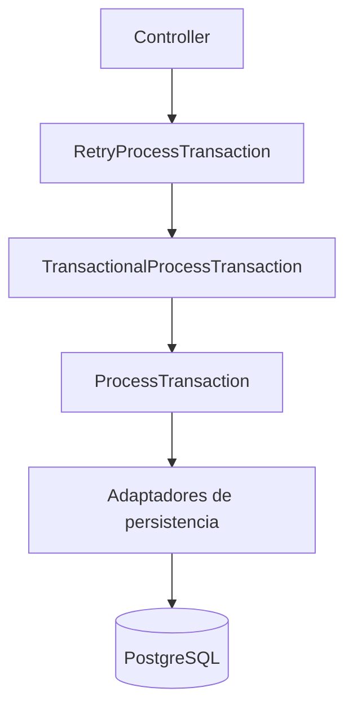
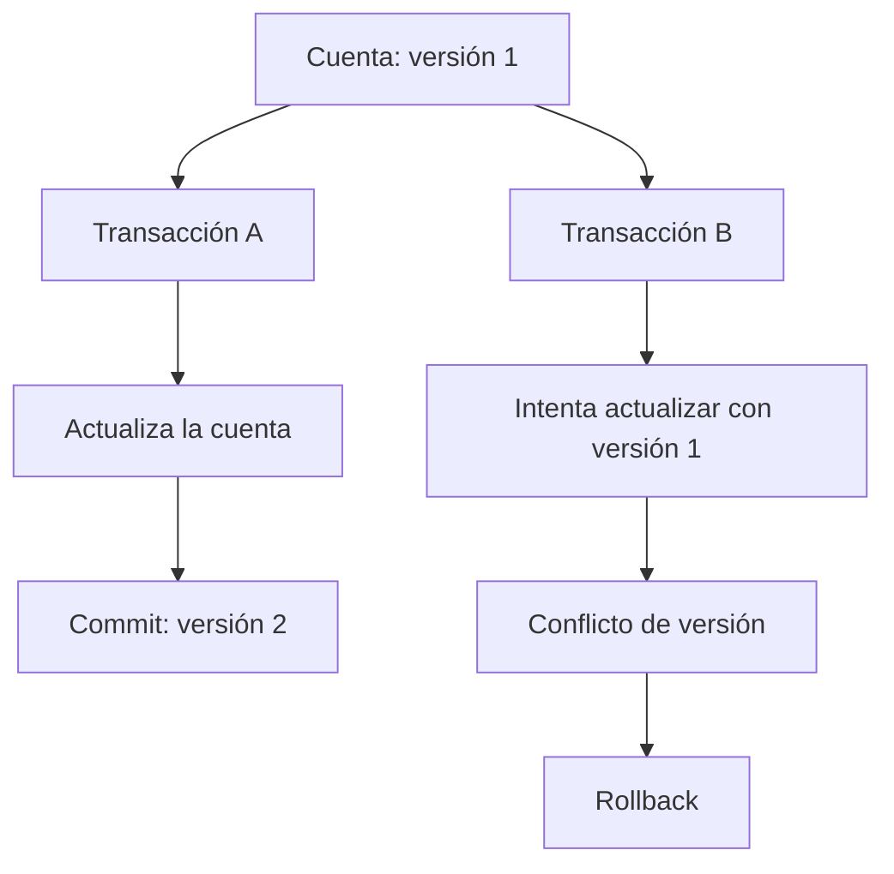
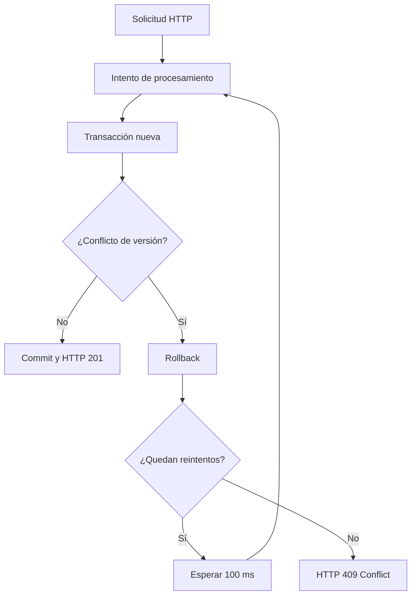
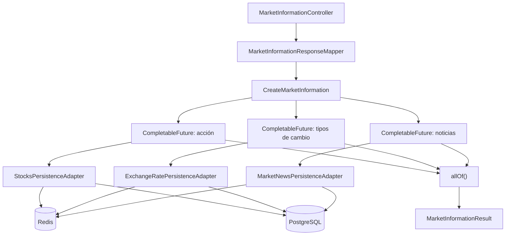
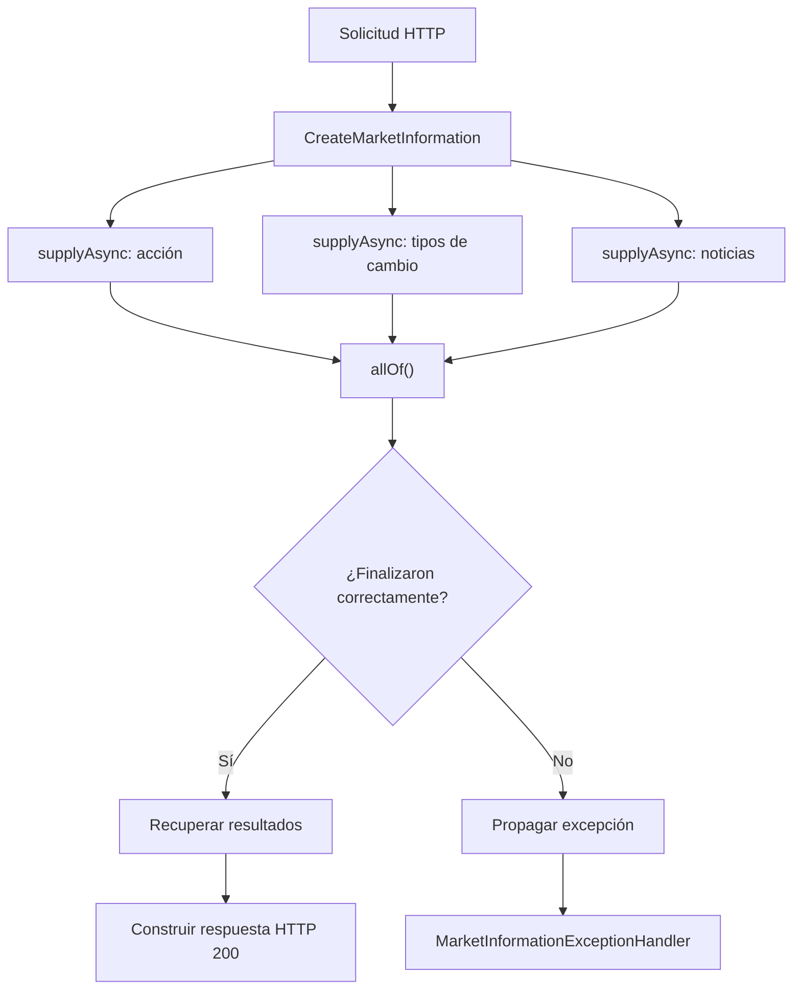

# Laboratorio de concurrencia y paralelismo en Java

Laboratorio práctico de Java 21 y Spring Boot orientado a comprender distintas formas de ejecutar
trabajo, identificar cuándo conviene utilizarlas y observar su comportamiento mediante métricas.

El proyecto utiliza escenarios financieros acotados para estudiar cuatro enfoques:

| Enfoque                          | Escenario de estudio                 | Propósito                                                                        |
|----------------------------------|--------------------------------------|----------------------------------------------------------------------------------|
| Ejecución secuencial             | Procesamiento de transacciones       | Respetar dependencias y el orden de las operaciones.                             |
| `CompletableFuture`              | Obtención de datos de mercado        | Coordinar operaciones de entrada/salida independientes.                          |
| Procesamiento paralelo CPU-bound | Análisis de transacciones históricas | Distribuir cálculos intensivos entre recursos de procesamiento.                  |
| Virtual threads                  | Consultas financieras concurrentes   | Atender numerosas tareas de entrada/salida con un modelo de concurrencia ligero. |

La finalidad es estudiar las características y los costos de cada técnica, medir su rendimiento y
comparar sus resultados. Los escenarios son ejercicios de laboratorio, no una implementación de un
sistema bancario de producción.

## Tecnologías

- **Java 21** y **Spring Boot 4** para la aplicación.
- **Spring Web** y **Jakarta Validation** para la API HTTP y la validación de solicitudes.
- **Spring Data JPA**, **Hibernate** y **PostgreSQL** para la persistencia.
- **Spring Transactions** para la gestión transaccional.
- **Spring Framework Resilience** para los reintentos controlados.
- **Redis** para el almacenamiento temporal de información de mercado.
- **Micrometer**, **Spring Boot Actuator** y **Prometheus** para las métricas.
- **HikariCP** para la gestión del pool de conexiones.
- **Docker Compose** para los servicios locales.
- **Maven**, **Postman** y **DBeaver** para construcción, pruebas e inspección de datos.

## Módulo 1 — Gestión de transacciones

### Objetivo

Procesar un débito sobre una cuenta mediante un flujo **secuencial**: cada etapa utiliza o depende
del resultado de una etapa anterior. El escenario permite observar el costo de las operaciones de
persistencia, además de comprobar el resultado funcional del procesamiento.

La ejecución secuencial describe el **orden de las etapas dentro de cada transacción**. No implica,
por sí sola, que el servidor HTTP acepte una única solicitud a la vez.

El módulo también permite estudiar la integridad transaccional y los conflictos producidos cuando
varias solicitudes intentan modificar simultáneamente una misma cuenta.

### Flujo funcional

1. Recibir una solicitud de transacción.
2. Buscar la cuenta en PostgreSQL.
3. Comprobar que la cuenta exista y esté activa.
4. Verificar que la operación solicitada sea un débito.
5. Comprobar que el saldo alcance para cubrir el importe.
6. Debitar el importe de la cuenta.
7. Guardar la cuenta con el saldo actualizado.
8. Crear y completar la transacción.
9. Guardar el registro de la transacción.
10. Confirmar la transacción de base de datos.
11. Devolver el resultado del procesamiento.

Las condiciones de rechazo interrumpen el flujo antes de realizar el débito. La operación utiliza
los modelos de dominio para administrar el saldo y el estado de la transacción.

El débito y el registro de la transacción participan de una misma transacción de PostgreSQL.
Si ocurre un error que provoca rollback, ninguna de las escrituras queda confirmada.

### Arquitectura

El módulo sigue una **arquitectura hexagonal** con tres responsabilidades diferenciadas:

| Capa            | Responsabilidad                                                          |
|-----------------|--------------------------------------------------------------------------|
| Dominio         | Modelos `Account` y `Transaction`, estados y operaciones de negocio.     |
| Aplicación      | Caso de uso `ProcessTransaction` y contratos de entrada y salida.        |
| Infraestructura | API REST, entidades JPA, adaptadores, mappers, configuración y métricas. |

Los contratos de aplicación separan el caso de uso de los mecanismos de persistencia. La
infraestructura implementa esos contratos y convierte los datos entre las representaciones HTTP,
de dominio y de base de datos.

La gestión transaccional y los reintentos se implementan mediante decoradores de infraestructura:

- `ProcessTransaction`: ejecuta las validaciones y operaciones del caso de uso.
- `TransactionalProcessTransaction`: establece el límite transaccional mediante `@Transactional`.
- `RetryProcessTransaction`: administra los reintentos mediante `@Retryable`.

Los tres componentes implementan o utilizan el contrato `ProcessTransactionUseCase`, manteniendo
la lógica de aplicación independiente de las anotaciones de Spring.

`ProcessTransferConfig` registra los componentes y establece su orden de ejecución.



El decorador de reintentos envuelve al transaccional. De esta manera, cada nuevo intento vuelve a
ejecutar el caso de uso dentro de una transacción independiente.

### Modelo de datos

La información se almacena en dos tablas de PostgreSQL:

**`accounts`**

| Campo      | Tipo en Java    | Significado                        |
|------------|-----------------|------------------------------------|
| `id`       | `UUID`          | Identificador de cuenta.           |
| `holder`   | `String`        | Titular.                           |
| `balance`  | `BigDecimal`    | Saldo.                              |
| `currency` | `Currency`      | Moneda.                             |
| `status`   | `AccountStatus` | Estado de la cuenta.               |
| `version`  | `Long`          | Versión para bloqueo optimista.    |

**`transactions`**

| Campo       | Tipo en Java     | Significado                      |
|-------------|------------------|----------------------------------|
| `id`        | `UUID`           | Identificador de la transacción. |
| `accountId` | `UUID`           | Cuenta asociada.                 |
| `type`      | `TransferType`   | Tipo de operación.               |
| `amount`    | `BigDecimal`     | Importe.                         |
| `createdAt` | `Instant`        | Fecha de creación.               |
| `status`    | `TransferStatus` | Estado de procesamiento.         |
| `category`  | `Category`       | Categoría.                       |

Una cuenta puede estar asociada a múltiples transacciones. Los importes utilizan `BigDecimal`,
los identificadores utilizan `UUID` y los estados y categorías se representan mediante enums.

La versión de la cuenta se conserva en el dominio y se transporta mediante `AccountMapper`.
Hibernate administra su incremento a través de `@Version` en `AccountEntity`.

### API REST

**`POST /api/transactions`**

Recibe los siguientes datos:

| Campo       | Tipo           | Descripción                                |
|-------------|----------------|--------------------------------------------|
| `accountId` | UUID           | Cuenta sobre la que se solicita el débito. |
| `type`      | `TransferType` | Tipo de transacción.                       |
| `amount`    | `BigDecimal`   | Importe positivo.                          |
| `category`  | `Category`     | Categoría de la operación.                 |

Ejemplo de solicitud:

```json
{
  "accountId": "10000000-0000-0000-0000-000000000002",
  "type": "DEBIT",
  "amount": 100.00,
  "category": "FOOD"
}
```

Una ejecución exitosa devuelve **HTTP `201 Created`**, con `id`, `status` y `message`:

```json
{
  "id": "599be711-f43c-486d-be63-50836a84cb5a",
  "status": "COMPLETED",
  "message": "La transacción se ha procesado correctamente"
}
```

El controlador valida la solicitud, utiliza un mapper para convertirla en el comando de aplicación
y devuelve el resultado mediante un DTO de respuesta.

### Gestión transaccional

El procesamiento utiliza `@Transactional` en `TransactionalProcessTransaction`, ubicado en
infraestructura.

Esta separación permite mantener `ProcessTransaction` como una clase Java independiente de Spring.

El límite transaccional incluye las operaciones de actualización del saldo y registro de la
transacción. Ambas deben confirmarse juntas.

Si falla el registro de la transacción después de modificar la cuenta, Spring realiza el rollback
y PostgreSQL conserva el saldo anterior.

El comportamiento se comprobó provocando una excepción durante el procesamiento y verificando
que el saldo no cambiara. Posteriormente, se repitió el débito sin la excepción y se confirmó
su persistencia.

### Bloqueo optimista

La entidad `AccountEntity` utiliza `@Version` para detectar actualizaciones concurrentes.

Hibernate comprueba que la versión utilizada para actualizar una cuenta coincida con la versión
almacenada en PostgreSQL.

Si otra transacción modificó la cuenta, la actualización falla y Spring puede lanzar
`ObjectOptimisticLockingFailureException`.



El bloqueo optimista evita que una operación sobrescriba silenciosamente los cambios confirmados
por otra transacción.

El modelo de dominio conserva la versión, mientras que Hibernate administra su actualización.
La comparación de versiones no se realiza manualmente dentro de `Account`.

### Reintentos controlados

`RetryProcessTransaction` utiliza `@Retryable` de Spring Framework para volver a ejecutar el
procesamiento cuando ocurre un conflicto de bloqueo optimista.

La configuración establece:

| Parámetro    | Valor                                            |
|--------------|--------------------------------------------------|
| Excepción    | `ObjectOptimisticLockingFailureException`        |
| `maxRetries` | `3`                                              |
| `delay`      | `100` milisegundos                               |
| Límite       | Un intento inicial y tres reintentos adicionales |

Cada reintento inicia una transacción nueva, vuelve a consultar la cuenta y repite las validaciones
sobre el saldo actualizado.

Las excepciones de negocio, como la falta de saldo, no forman parte de los errores configurados
para reintentar.



El reintento se aplica por fuera del límite transaccional. Esto evita reutilizar una transacción
fallida y permite que cada ejecución consulte nuevamente el estado de PostgreSQL.

### Manejo de excepciones

La infraestructura incluye `GlobalExceptionHandler`, basado en `@RestControllerAdvice`, y un
modelo de respuesta `ErrorResponse`.

Las respuestas de error utilizan los campos:

- `timestamp`: momento en que se genera la respuesta.
- `status`: código HTTP.
- `error`: descripción del estado HTTP.
- `message`: explicación del error.
- `path`: ruta de la solicitud.

El manejador contempla las siguientes situaciones:

| Situación                              | Respuesta HTTP |
|----------------------------------------|----------------|
| Datos de entrada inválidos             | `400`          |
| Argumentos de negocio inválidos        | `400`          |
| Estado incompatible con la operación   | `409`          |
| Conflicto de versión sin resolución    | `409`          |
| Error inesperado                       | `500`          |

Los conflictos de versión que persisten después de agotar los reintentos se comunican al cliente
mediante HTTP `409 Conflict`, sin confirmar el débito fallido.

### Persistencia

La persistencia utiliza Spring Data JPA y PostgreSQL. Las entidades JPA se mantienen separadas de
los modelos del dominio, y los adaptadores implementan los puertos definidos por la aplicación.

`AccountPersistenceAdapter` recupera y guarda cuentas utilizando `AccountMapper`, que conserva
la versión entre las representaciones de dominio y persistencia.

La actualización utiliza `repository.save()`. Hibernate verifica la versión durante la
persistencia y detecta los conflictos de concurrencia.

Se utilizan índices para consultar transacciones por cuenta, fecha y categoría. El procesamiento
del módulo no utiliza caché Redis.

### Observabilidad

El laboratorio utiliza **Micrometer** y **Spring Boot Actuator** para consultar métricas de
rendimiento. En el caso de uso se miden individualmente tres operaciones de persistencia:

| Operación           | Identificador de tarea |
|---------------------|------------------------|
| Buscar cuenta       | `find_account`         |
| Guardar cuenta      | `save_account`         |
| Guardar transacción | `save_transaction`     |

La métrica `lab.execution.duration` utiliza etiquetas para distinguir el proceso y la tarea. Sus
estadísticas permiten conocer la cantidad de mediciones (`COUNT`), el tiempo acumulado
(`TOTAL_TIME`) y la duración máxima (`MAX`).

Los endpoints de Actuator permiten consultar las métricas disponibles y las series individuales:

- `/actuator/metrics`
- `/actuator/metrics/lab.execution.duration`
- `/actuator/prometheus`

También se observan las métricas automáticas de JDBC, HikariCP, JVM y HTTP. Las duraciones de
persistencia medidas alrededor de los adaptadores no equivalen necesariamente al tiempo de una
sentencia SQL aislada ni al tiempo total de respuesta HTTP.

Las pruebas de concurrencia también permiten observar los conflictos de versión, los reintentos
y las respuestas HTTP producidas bajo solicitudes simultáneas.

### Pruebas del escenario

#### Procesamiento secuencial

La API se probó desde Postman, con verificación del saldo de la cuenta y del registro de la
transacción en PostgreSQL mediante DBeaver.

Se ejecutaron **20 solicitudes consecutivas** desde Postman Collection Runner y las 20 recibieron
**HTTP `201 Created`**. El procesamiento conservó el orden interno de sus operaciones.

Micrometer registró las mediciones de lectura y escritura, que permiten analizar el costo de
la persistencia a partir de ejecuciones repetidas.

#### Integridad transaccional

Se verificaron dos situaciones:

1. Una excepción posterior a la actualización de la cuenta produjo rollback y conservó el saldo.
2. Un procesamiento sin errores confirmó el débito y el registro de la transacción.

Estas pruebas comprobaron el comportamiento de `@Transactional` ante confirmaciones y errores.

#### Concurrencia y bloqueo optimista

Se utilizó `ConcurrencyProbe.java`, un ejecutable de prueba independiente basado en Java 21,
para enviar 30 solicitudes HTTP simultáneas contra una misma cuenta.

Cada solicitud intentó realizar un débito de $1.000.

En una ejecución se obtuvieron los siguientes resultados:

| Resultado                      | Valor   |
|--------------------------------|---------|
| Solicitudes concurrentes       | 30      |
| Operaciones exitosas           | 22      |
| Conflictos HTTP `409`          | 8       |
| Otros errores                  | 0       |
| Duración total                 | 1886 ms |

La base de datos permitió verificar la consistencia de las operaciones confirmadas:

| Dato               | Antes     | Después   | Diferencia |
|--------------------|-----------|-----------|------------|
| Saldo              | $168.000  | $146.000  | -$22.000   |
| Versión            | 73        | 95        | +22        |

El saldo disminuyó exactamente por los 22 débitos exitosos. La versión aumentó una vez por cada
actualización confirmada.

Las operaciones rechazadas por conflictos de versión no produjeron descuentos adicionales.

#### Verificación de reintentos

Durante la misma prueba se incorporó temporalmente un registro de ejecución en
`RetryProcessTransaction`.

Los logs permitieron identificar 58 ejecuciones del método para las 30 solicitudes recibidas.

Al agrupar las ejecuciones por hilo HTTP, se observó la siguiente distribución:

| Ejecuciones por solicitud | Solicitudes |
|---------------------------|-------------|
| 1                         | 20          |
| 2                         | 1           |
| 3                         | 0           |
| 4                         | 9           |
| **Total**                 | **30**      |

La prueba confirmó la ejecución de reintentos y no mostró solicitudes que superaran el límite
configurado de un intento inicial y tres reintentos adicionales.

Los resultados muestran que el procesamiento mantiene la integridad del saldo bajo solicitudes
concurrentes y comunica los conflictos que no pudieron resolverse.

Las mediciones corresponden al escenario ejecutado y no representan una estimación de la capacidad
máxima del sistema ni una garantía de rendimiento bajo otras cargas.

## Módulo 2 — Información de mercado

### Objetivo

Obtener información financiera mediante la ejecución **concurrente de operaciones de entrada/salida
independientes**, utilizando `CompletableFuture` para coordinar sus resultados.

El escenario reúne tres consultas:

1. Información de una acción identificada por su símbolo.
2. Tipos de cambio filtrados por moneda de origen y destino.
3. Las cinco noticias de mercado más recientes.

Las tres consultas no dependen entre sí. Por lo tanto, pueden ejecutarse simultáneamente en lugar
de esperar a que termine una para comenzar la siguiente.

El módulo permite estudiar la coordinación de tareas asíncronas, el uso de un ejecutor compartido,
la persistencia de lectura, el almacenamiento temporal en Redis y la tolerancia a fallos.

La ejecución concurrente no implica que cada solicitud utilice necesariamente tres hilos exclusivos.
Los hilos pertenecen a un ejecutor compartido y su disponibilidad depende de la carga del sistema.

### Flujo funcional

1. Recibir una solicitud HTTP con el símbolo de la acción y los filtros de monedas.
2. Validar los parámetros y construir el comando de aplicación.
3. Iniciar la medición del tiempo total del caso de uso.
4. Crear tres tareas independientes mediante `CompletableFuture.supplyAsync()`.
5. Consultar la acción, los tipos de cambio y las noticias utilizando sus respectivos adaptadores.
6. Buscar los datos en Redis y utilizar PostgreSQL cuando no se encuentren en caché.
7. Guardar temporalmente en Redis los resultados recuperados de PostgreSQL.
8. Coordinar la finalización de las tres tareas mediante `CompletableFuture.allOf()`.
9. Recuperar los resultados individuales y construir `MarketInformationResult`.
10. Convertir el resultado de aplicación en la respuesta HTTP.
11. Devolver la información financiera mediante HTTP `200 OK`.

Las consultas son independientes y pueden finalizar en distinto orden. Sin embargo, la respuesta
se construye después de que las tres tareas completan correctamente su ejecución.

Si una operación produce una excepción, la solicitud no devuelve un resultado parcial. El error se
propaga hasta la infraestructura HTTP, donde se determina la respuesta correspondiente.

### Arquitectura

El módulo sigue una **arquitectura hexagonal**, separando las responsabilidades de dominio,
aplicación e infraestructura.

| Capa            | Responsabilidad                                                                         |
|-----------------|-----------------------------------------------------------------------------------------|
| Dominio         | Modelos `Stocks`, `ExchangeRate` y `MarketNews`, junto con sus enumeraciones.           |
| Aplicación      | Caso de uso `CreateMarketInformation`, comando, resultados y contratos de persistencia. |
| Infraestructura | API REST, PostgreSQL, Redis, adaptadores, mappers, configuración, reintentos y métricas. |

El contrato `MarketInformation` define la operación de entrada del caso de uso.

Los puertos `StocksPersistence`, `ExchangeRatePersistence` y `MarketNewsPersistence` permiten que
la aplicación consulte información sin conocer los mecanismos de acceso a PostgreSQL o Redis.

`MarketMetrics` establece el contrato utilizado para medir las operaciones de aplicación.

La infraestructura implementa estos contratos mediante adaptadores independientes para cada
recurso financiero.



Los adaptadores consultan Redis antes de acceder a PostgreSQL. Las conexiones del diagrama
representan los mecanismos disponibles, no dos consultas obligatorias para cada operación.

`MarketInformationConfig` registra el caso de uso y habilita los métodos resilientes de Spring.

`ExecutorConfig` configura el ejecutor utilizado por las tareas asíncronas.

`RedisConfig` proporciona el `RedisTemplate` empleado por los repositorios de caché.

### Ejecución concurrente con CompletableFuture

El caso de uso utiliza tres llamadas a `CompletableFuture.supplyAsync()`, una por cada consulta
financiera.

Cada tarea recibe el mismo `Executor`, pero ejecuta su propia operación de persistencia.

| Tarea         | Operación de aplicación | Resultado                   |
|---------------|-------------------------|-----------------------------|
| Acción        | `getStock`              | `StockResult`               |
| Tipos de cambio | `getExchangeRate`     | Lista de `ExchangeRateResult` |
| Noticias      | `getMarketNews`         | Lista de `MarketNewsResult` |

Las tareas se inician sin esperar secuencialmente sus resultados.

`CompletableFuture.allOf()` permite coordinar su finalización. Una vez completadas, el caso de uso
recupera cada resultado mediante `join()`.

La respuesta conserva una estructura definida, independientemente del orden en que terminen las
consultas.



El ejecutor está configurado mediante `Executors.newFixedThreadPool(3)` y se registra con el nombre
`marketInformationExecutor`.

Los tres hilos del pool son compartidos entre las solicitudes. Cuando todos están ocupados, nuevas
tareas deben esperar hasta que alguno quede disponible.

Spring administra el ciclo de vida del ejecutor y llama a `shutdown()` cuando se destruye el bean.

Esta configuración permite estudiar tanto la ejecución concurrente de consultas independientes
como el comportamiento de un número limitado de hilos ante múltiples solicitudes HTTP.

### Modelo de datos

La información se almacena en tres tablas de PostgreSQL:

**`stocks`**

| Campo            | Tipo en Java | Significado                              |
|------------------|--------------|------------------------------------------|
| `symbol`         | `String`     | Símbolo identificador de la acción.      |
| `price`          | `BigDecimal` | Precio de la acción.                     |
| `change_percent` | `BigDecimal` | Variación porcentual del precio.         |
| `volume`         | `Long`       | Volumen registrado.                      |
| `update_at`      | `Instant`    | Fecha de actualización de la cotización. |

El símbolo es la clave primaria y permite recuperar una acción mediante `findById()`.

**`exchange_rates`**

| Campo           | Tipo en Java | Significado                              |
|-----------------|--------------|------------------------------------------|
| `id`            | `UUID`       | Identificador del tipo de cambio.        |
| `from_currency` | `Currency`   | Moneda de origen.                        |
| `to_currency`   | `Currency`   | Moneda de destino.                       |
| `rate`          | `BigDecimal` | Valor del tipo de cambio.                |
| `update_at`     | `Instant`    | Fecha de actualización.                  |

Las monedas se representan mediante el enum `Currency`, que contiene `USD`, `ARG` y `EUR`.

La tabla establece una restricción de unicidad sobre la combinación de moneda de origen y destino.

**`market_news`**

| Campo       | Tipo en Java | Significado                             |
|-------------|--------------|-----------------------------------------|
| `id`        | `UUID`       | Identificador de la noticia.            |
| `title`     | `String`     | Título de la noticia.                   |
| `source`    | `String`     | Fuente de información.                  |
| `timestamp` | `Instant`    | Fecha y hora de publicación.            |
| `sentiment` | `Sentiment`  | Clasificación del sentimiento.          |

El enum `Sentiment` contempla los valores `POSITIVE`, `NEGATIVE` y `NEUTRAL`.

Los importes y las cotizaciones utilizan `BigDecimal`; los identificadores de noticias y tipos de
cambio utilizan `UUID`, y las fechas se representan mediante `Instant`.

Las entidades JPA se mantienen separadas de los modelos de dominio.

### API REST

**`GET /api/market-information`**

La solicitud utiliza parámetros de consulta:

| Parámetro      | Tipo       | Descripción                                             |
|----------------|------------|---------------------------------------------------------|
| `symbol`       | `String`   | Símbolo obligatorio de la acción, con máximo 10 caracteres. |
| `fromCurrency` | `Currency` | Filtro de moneda de origen.                             |
| `toCurrency`   | `Currency` | Filtro de moneda de destino.                            |

Debe indicarse al menos una de las dos monedas.

Ejemplo de solicitud:

```http
GET /api/market-information?symbol=AAPL&fromCurrency=USD&toCurrency=EUR
```

Una ejecución exitosa devuelve **HTTP `200 OK`** con la información de la acción, los tipos de
cambio encontrados y las cinco noticias más recientes.

Ejemplo de respuesta:

```json
{
  "stockResult": {
    "symbol": "AAPL",
    "price": 41.27,
    "changePercent": -4.95,
    "volume": 10051,
    "updateAt": "2026-11-05T02:15:19.748920Z"
  },
  "exchangeRateResult": [
    {
      "fromCurrency": "USD",
      "toCurrency": "EUR",
      "rate": 0.90,
      "updatedAt": "2026-11-05T02:16:19.748920Z"
    }
  ],
  "marketNewsResult": [
    {
      "title": "Noticia sintetica de mercado 1",
      "source": "Noticias Financieras",
      "timestamp": "2026-11-05T02:15:19.748920Z",
      "sentiment": "NEGATIVE"
    },
    {
      "title": "Noticia sintetica de mercado 2",
      "source": "Mercados",
      "timestamp": "2026-11-05T02:14:19.748920Z",
      "sentiment": "NEUTRAL"
    },
    {
      "title": "Noticia sintetica de mercado 3",
      "source": "Market Lab",
      "timestamp": "2026-11-05T02:13:19.748920Z",
      "sentiment": "POSITIVE"
    },
    {
      "title": "Noticia sintetica de mercado 4",
      "source": "Noticias Financieras",
      "timestamp": "2026-11-05T02:12:19.748920Z",
      "sentiment": "NEGATIVE"
    },
    {
      "title": "Noticia sintetica de mercado 5",
      "source": "Mercados",
      "timestamp": "2026-11-05T02:11:19.748920Z",
      "sentiment": "NEUTRAL"
    }
  ]
}
```

`MarketInformationController` recibe los parámetros mediante `GetMarketInformationRequest` y
utiliza `MarketInformationResponseMapper` para construir el comando de aplicación.

La respuesta se construye mediante `MarketInformationResponse` y los DTO independientes
`StockResponse`, `ExchangeRateResponse` y `MarketNewsResponse`.

Los mappers REST convierten los resultados de aplicación en objetos de respuesta sin exponer las
entidades de persistencia.

### Persistencia

Las consultas utilizan **Spring Data JPA y PostgreSQL** como fuente de información persistente.

Cada recurso dispone de un repositorio, un mapper y un adaptador propios:

| Recurso        | Repositorio JPA          | Adaptador                       |
|----------------|-------------------------|---------------------------------|
| Acciones       | `StocksRepository`      | `StocksPersistenceAdapter`      |
| Tipos de cambio | `ExchangeRateRepository` | `ExchangeRatePersistenceAdapter` |
| Noticias       | `MarketNewsRepository`  | `MarketNewsPersistenceAdapter`  |

`StocksRepository` recupera acciones mediante el identificador heredado de `JpaRepository`.

`ExchangeRateRepository` utiliza una consulta JPQL que permite filtrar por moneda de origen,
moneda de destino o ambas.

`MarketNewsRepository` recupera las cinco noticias más recientes, ordenadas por fecha de
publicación descendente.

Las consultas personalizadas de tipos de cambio y noticias utilizan
`@Transactional(readOnly = true)`.

Las consultas se ejecutan en los hilos administrados por el ejecutor. El caso de uso no establece
una única transacción compartida entre los tres `CompletableFuture`.

Cada adaptador transforma los datos de persistencia en modelos del dominio antes de devolverlos a
la aplicación.

### Caché Redis

El módulo implementa una estrategia **cache-aside** para reducir consultas repetidas a PostgreSQL.

Cada recurso dispone de un repositorio Redis y de un mapper para convertir los datos entre los
modelos de dominio y los valores almacenados en caché.

El funcionamiento es el siguiente:

1. El adaptador consulta Redis utilizando la clave del recurso.
2. Si encuentra información, la convierte en modelo de dominio y la devuelve.
3. Si no encuentra información, consulta PostgreSQL.
4. Convierte el resultado obtenido al formato de caché.
5. Guarda el resultado temporalmente en Redis.
6. Devuelve los datos al caso de uso.

Las claves utilizadas son:

| Recurso        | Clave Redis                         | Duración |
|----------------|-------------------------------------|----------|
| Acción         | `stock:{symbol}`                    | 30 s     |
| Tipos de cambio | `exchange-rate:{origen}:{destino}` | 30 s     |
| Noticias       | `market-news:latest-five`           | 30 s     |

Cuando no se indica uno de los filtros de monedas, su componente de la clave utiliza `ALL`.

Los valores se serializan a JSON mediante `JsonMapper` y se almacenan utilizando
`RedisTemplate<String, String>`.

El tiempo de vida de 30 segundos permite observar el comportamiento de las consultas cuando la
información existe en caché y cuando debe recuperarse nuevamente desde PostgreSQL.

### Tolerancia a fallos de Redis

Los tres adaptadores manejan las excepciones producidas durante la lectura o escritura en Redis.

Si Redis no está disponible, la consulta a PostgreSQL continúa siendo el mecanismo para obtener
la información.

El fallo de la caché no debe impedir una consulta que pueda resolverse desde la base de datos.

Las operaciones de lectura y escritura de Redis se ejecutan dentro de bloques independientes
`try/catch`, registrando los errores mediante SLF4J.

La conexión Redis utiliza los siguientes límites:

| Parámetro         | Valor |
|-------------------|-------|
| `connect-timeout` | 500 ms |
| `timeout`         | 500 ms |

Estos valores se configuran en `application.yaml` y limitan el tiempo de espera para establecer
la conexión y ejecutar operaciones Redis.

La configuración permite que los adaptadores reciban una excepción rápidamente cuando Redis no
responde y continúen con PostgreSQL.

La recuperación de Redis no requiere reconstruir el caso de uso. Las consultas posteriores pueden
volver a utilizar la caché normalmente.

### Reintentos controlados de PostgreSQL

El módulo utiliza `@Retryable` de Spring Framework para reintentar consultas que producen errores
transitorios de acceso a datos.

Los reintentos están implementados mediante tres componentes independientes:

- `RetryStocksQuery`: consulta de acciones.
- `RetryExchangeRateQuery`: consulta de tipos de cambio.
- `RetryMarketNewsQuery`: consulta de noticias.

Cada componente recibe su repositorio JPA y aplica los reintentos exclusivamente sobre la
operación de lectura correspondiente.

La configuración es equivalente en los tres casos:

| Parámetro    | Valor                                  |
|--------------|----------------------------------------|
| Excepción    | `TransientDataAccessException`         |
| `maxRetries` | `3`                                    |
| `delay`      | `100` milisegundos                     |
| Límite       | Un intento inicial y tres reintentos   |

Un error transitorio puede provocar hasta cuatro ejecuciones de la consulta: una inicial y tres
reintentos adicionales.

Si una ejecución posterior tiene éxito, el resultado vuelve al adaptador y continúa el flujo
normal de recuperación y almacenamiento en caché.

Si todos los intentos fallan, la excepción se propaga para que la infraestructura HTTP determine
la respuesta correspondiente.

Los reintentos no se aplican sobre Redis ni sobre la ejecución completa del caso de uso. Esto evita
repetir operaciones independientes que ya finalizaron correctamente.

### Tiempo máximo de ejecución

El caso de uso establece un límite de **5 segundos** sobre la coordinación de las tres tareas
mediante `CompletableFuture.allOf().orTimeout()`.

Este límite controla cuánto tiempo espera la operación conjunta antes de informar que se agotó
el tiempo disponible.

Si las tres tareas finalizan correctamente dentro del plazo, se recuperan los resultados y se
construye la respuesta HTTP.

Si se agota el tiempo, `CompletableFuture` completa excepcionalmente la operación coordinadora
con un `TimeoutException`.

`MarketInformationExceptionHandler` convierte esa situación en una respuesta
**HTTP `504 Gateway Timeout`**.

El timeout no interrumpe automáticamente las consultas que continúan ejecutándose en los hilos
del ejecutor. Su función es limitar la espera del caso de uso por el resultado conjunto.

Las métricas del caso de uso se registran mediante un bloque `finally`, incluso cuando alguna
operación termina con una excepción.

### Manejo de excepciones

La infraestructura utiliza `MarketInformationExceptionHandler`, basado en
`@RestControllerAdvice`, y un modelo `ErrorResponse`.

El manejador está limitado a los controladores del paquete `marketInformation`, manteniendo
separado el tratamiento de errores de los demás módulos.

Las respuestas de error utilizan los campos:

- `timestamp`: momento en que se genera la respuesta.
- `status`: código HTTP.
- `error`: descripción del estado HTTP.
- `message`: explicación del error.
- `path`: ruta de la solicitud.

El manejador contempla las siguientes situaciones:

| Situación                                  | Respuesta HTTP |
|--------------------------------------------|----------------|
| Solicitud o parámetros inválidos           | `400`          |
| Argumentos inválidos del caso de uso        | `400`          |
| Error transitorio de PostgreSQL sin resolver | `503`        |
| Tiempo máximo de ejecución agotado         | `504`          |
| Error inesperado                           | `500`          |

Las excepciones generadas durante las tareas asíncronas pueden propagarse mediante
`CompletionException`.

El manejador examina su causa para distinguir errores de validación, fallos transitorios de
PostgreSQL y agotamientos del tiempo de espera.

Las respuestas se construyen de manera uniforme mediante `ErrorResponse`, sin devolver al cliente
los detalles internos de las excepciones inesperadas.

### Observabilidad

El módulo utiliza **Micrometer** y **Spring Boot Actuator** para medir la duración de las consultas
y el comportamiento de Redis.

`MarketInformationMetrics` implementa el contrato `MarketMetrics` y registra las duraciones
mediante la métrica `lab.execution.duration`.

Las operaciones medidas son:

| Operación                     | Etiqueta `method`    | Etiqueta `task`       |
|-------------------------------|----------------------|-----------------------|
| Obtener información de mercado | `getMarketinformation` | `completable_future` |
| Buscar acción                 | `getStock`           | `find_stock`          |
| Consultar tipos de cambio     | `getExchangeRate`    | `find_by_currencies`  |
| Consultar noticias            | `getMarketNews`      | `find_latest_five`    |

La medición general comprende la espera de las tres tareas y la recuperación de sus resultados.

Las mediciones individuales permiten observar cuánto tarda cada operación, incluyendo el acceso
a Redis o PostgreSQL realizado mediante su adaptador.

`MarketCacheMetrics` registra las consultas a caché mediante el contador `lab.cache.requests`.

Este contador utiliza dos etiquetas:

| Etiqueta   | Valores                                  |
|------------|------------------------------------------|
| `resource` | `stocks`, `exchange_rate`, `market_news` |
| `result`   | `hit`, `miss`                            |

Un `hit` indica que Redis devolvió información almacenada.

Un `miss` indica que la consulta no encontró información en caché y continuó hacia PostgreSQL.

Las métricas pueden consultarse mediante los endpoints:

- `/actuator/metrics`
- `/actuator/metrics/lab.execution.duration`
- `/actuator/metrics/lab.cache.requests`
- `/actuator/prometheus`

También se dispone de las métricas automáticas de JVM, HTTP, JDBC y HikariCP.

Las duraciones medidas permiten estudiar el comportamiento de las consultas, pero no equivalen
necesariamente al tiempo de una sentencia SQL aislada.

La comparación entre `hit` y `miss` permite observar cómo influye Redis en el tiempo de respuesta
de las operaciones.

### Pruebas del escenario

Se utiliza `MarketInformationProbe.java`, ubicado en la carpeta `scripts/`, para ejecutar las
pruebas funcionales, de concurrencia, de tolerancia a fallos y de observabilidad.

El ejecutable utiliza Java 21 y permite seleccionar cada escenario desde un menú.

Las pruebas incluyen consultas reales contra la aplicación y verificaciones aisladas con
componentes de Spring.

#### Compilación y consulta REST

Se comprobó la compilación mediante Maven y el arranque de Spring Boot.

El endpoint `/actuator/health` devolvió HTTP `200` con el estado `UP`.

La consulta de mercado se ejecutó utilizando el símbolo `AAPL` y el par de monedas `USD/EUR`.

La API devolvió HTTP `200 OK`, incluyendo:

- Información de la acción.
- Tipos de cambio correspondientes a los filtros.
- Las cinco noticias más recientes.

La respuesta confirmó la integración entre el controlador, los mappers, el caso de uso y los
adaptadores de persistencia.

#### Caché Redis

Se comprobaron los escenarios de ausencia y presencia de datos en caché.

Para verificar un `cache miss`, se eliminaron las claves del escenario antes de realizar la
consulta HTTP.

La aplicación obtuvo los datos de PostgreSQL, respondió HTTP `200` y guardó las tres claves en
Redis.

Las métricas registraron un incremento de una unidad en los contadores de `miss` para los tres
recursos.

Posteriormente, se repitió la consulta con los datos almacenados.

Las tres métricas de `hit` aumentaron una unidad y la API volvió a responder HTTP `200`.

Las pruebas permitieron comprobar las dos rutas de lectura de la estrategia cache-aside.

#### Fallo y recuperación de Redis

Se detuvo temporalmente el contenedor Redis mediante Docker Compose.

Con Redis detenido, se ejecutó una nueva consulta HTTP contra el módulo.

La aplicación devolvió **HTTP `200 OK`**, obteniendo la información desde PostgreSQL.

Finalizada la prueba, el script inició nuevamente el contenedor Redis y confirmó su restauración.

La prueba comprobó que un fallo de la caché no impide recuperar información desde la base de datos
cuando PostgreSQL permanece disponible.

#### Reintentos de PostgreSQL

Se ejecutó una prueba aislada con Spring Framework y un repositorio simulado para provocar
excepciones transitorias controladas.

La prueba utilizó el componente real `RetryStocksQuery` y su configuración `@Retryable`.

Se comprobaron dos escenarios:

| Escenario                | Fallos simulados | Ejecuciones | Resultado                |
|--------------------------|------------------|-------------|--------------------------|
| Recuperación             | 2                | 3           | Consulta completada      |
| Error persistente        | 4                | 4           | Excepción propagada      |

En el primer escenario, dos consultas fallaron y el tercer intento terminó correctamente.

En el segundo, la excepción persistió durante la ejecución inicial y los tres reintentos.

Esta prueba confirmó el funcionamiento de `@Retryable` y el límite configurado de reintentos
utilizando el componente real con una dependencia simulada.

#### Concurrencia y métricas

Se ejecutaron diez solicitudes HTTP simultáneas contra el endpoint de información de mercado.

En una de las ejecuciones se obtuvieron los siguientes resultados:

| Resultado                    | Valor  |
|------------------------------|--------|
| Solicitudes concurrentes     | 10     |
| Respuestas HTTP `200`        | 10     |
| Errores                      | 0      |
| Duración total               | 72 ms  |
| Ejecuciones medidas          | 10     |

Micrometer registró las diez ejecuciones mediante `lab.execution.duration`.

La prueba confirmó que el módulo atendió correctamente las solicitudes simultáneas y registró
las mediciones del caso de uso.

El tiempo observado corresponde a esa ejecución y no representa la capacidad máxima del sistema.

Las respuestas HTTP y las métricas confirman el comportamiento de las solicitudes concurrentes,
pero no identifican por sí solas los hilos utilizados internamente por cada `CompletableFuture`.

#### Validación de solicitudes

Se enviaron solicitudes con distintos errores de entrada:

| Situación                         | Respuesta esperada | Respuesta obtenida |
|-----------------------------------|--------------------|--------------------|
| Símbolo vacío                     | `400`              | `400`              |
| Símbolo de más de 10 caracteres   | `400`              | `400`              |
| Ambas monedas ausentes            | `400`              | `400`              |
| Moneda inválida                   | `400`              | `400`              |

Todas las solicitudes recibieron HTTP `400 Bad Request`.

Las pruebas comprobaron la validación de parámetros y la conversión de errores de entrada en
respuestas HTTP.

#### Manejo de errores HTTP

Se realizaron pruebas aisladas mediante Spring MVC para verificar el manejador de excepciones
del módulo.

Se utilizaron controladores de prueba que provocaron errores controlados y permitieron comprobar
las respuestas generadas por `MarketInformationExceptionHandler`.

Los escenarios verificados fueron:

| Excepción simulada             | Respuesta HTTP |
|--------------------------------|----------------|
| `QueryTimeoutException`        | `503`          |
| `IllegalStateException`        | `500`          |

En ambos casos, Spring MVC devolvió el código esperado y el objeto `ErrorResponse` contenía
los valores correctos de `status` y `path`.

Las pruebas se realizaron en un contexto MVC aislado, sin detener PostgreSQL ni modificar la
aplicación en ejecución.

Los resultados permiten confirmar el tratamiento de las excepciones simuladas por la
infraestructura HTTP.

### Resultados del escenario

El módulo integra tres operaciones independientes mediante `CompletableFuture`, utilizando un
ejecutor compartido y una respuesta conjunta.

Las pruebas comprobaron el funcionamiento de la API REST, la recuperación y almacenamiento en
Redis, la continuidad del servicio ante la caída de la caché y los reintentos controlados frente
a excepciones transitorias simuladas.

También se verificaron las respuestas HTTP de validación, los errores internos simulados y el
registro de métricas durante solicitudes concurrentes.

El escenario permite estudiar la relación entre concurrencia, operaciones de entrada/salida,
capacidad del ejecutor y tiempo de respuesta.

Las mediciones corresponden a las condiciones de laboratorio utilizadas y no constituyen una
garantía de rendimiento bajo otras cargas o configuraciones.
