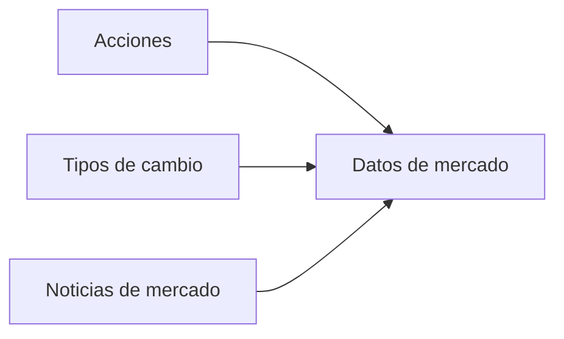

# Módulo 2 — Obtención de Datos de Mercado

## Entidades

### Acción

Representa la cotización de una acción consultada para obtener información del mercado.

| Campo           | Tipo Java    | Tipo PostgreSQL  | Descripción                                                 |
|-----------------|--------------|------------------|-------------------------------------------------------------|
| `symbol`        | `String`     | `VARCHAR(10)`    | Símbolo bursátil único. Clave primaria, por ejemplo `AAPL`. |
| `price`         | `BigDecimal` | `NUMERIC(19, 4)` | Precio de la acción.                                        |
| `changePercent` | `BigDecimal` | `NUMERIC(10, 4)` | Variación porcentual, positiva o negativa.                  |
| `volume`        | `long`       | `BIGINT`         | Volumen de operaciones.                                     |
| `updatedAt`     | `Instant`    | `TIMESTAMPTZ`    | Instante de la última actualización de la cotización.       |

**Tabla:** `stocks`.

El símbolo bursátil identifica naturalmente la acción; no es necesario reemplazarlo por un UUID.

### Tipo de cambio

Representa la cotización entre una moneda de origen y una moneda de destino.

| Campo            | Tipo Java         | Tipo PostgreSQL  | Descripción                                             |
|------------------|-------------------|------------------|---------------------------------------------------------|
| `sourceCurrency` | `Currency` (enum) | `VARCHAR(3)`     | Moneda de origen, por ejemplo `USD`.                    |
| `targetCurrency` | `Currency` (enum) | `VARCHAR(3)`     | Moneda de destino, por ejemplo `EUR`.                   |
| `rate`           | `BigDecimal`      | `NUMERIC(20, 8)` | Unidades de moneda destino por unidad de moneda origen. |
| `updatedAt`      | `Instant`         | `TIMESTAMPTZ`    | Instante de actualización de la cotización.             |

**Tabla:** `exchange_rates`.

La clave primaria es compuesta por `source_currency` y `target_currency`: cada par de monedas es único.

### Noticia de mercado

Representa una noticia financiera incluida en la consulta de información del mercado.

| Campo         | Tipo Java              | Tipo PostgreSQL | Descripción                                      |
|---------------|------------------------|-----------------|--------------------------------------------------|
| `id`          | `UUID`                 | `UUID`          | Identificador único. Clave primaria.             |
| `title`       | `String`               | `VARCHAR(200)`  | Título de la noticia.                            |
| `source`      | `String`               | `VARCHAR(50)`   | Fuente que publica la noticia.                   |
| `publishedAt` | `Instant`              | `TIMESTAMPTZ`   | Instante de publicación.                         |
| `sentiment`   | `NewsSentiment` (enum) | `VARCHAR(20)`   | Sentimiento: `POSITIVE`, `NEGATIVE` o `NEUTRAL`. |

**Tabla:** `market_news`.

## Relación entre entidades

Las tres entidades son independientes. No requieren claves foráneas entre sí.
La solicitud combina sus resultados después de obtenerlos en paralelo.

## Índices

| Tabla         | Índice                         | Columna        | Propósito                             |
|---------------|--------------------------------|----------------|---------------------------------------|
| `stocks`      | `idx_stocks_updated_at`        | `updated_at`   | Consultas por fecha de actualización. |
| `market_news` | `idx_market_news_published_at` | `published_at` | Obtener las noticias más recientes.   |

Las claves primarias de `stocks`, `exchange_rates` y `market_news` disponen de sus propios índices.

## Alcance técnico del módulo

- **Persistencia:** PostgreSQL mediante Spring Data JPA.
- **Ejecución:** consultas independientes en paralelo mediante `CompletableFuture.supplyAsync()`.
- **Sincronización:** `CompletableFuture.allOf()` espera los resultados antes de consolidarlos.
- **Caché:** Redis con patrón *cache-aside* para acciones y tipos de cambio.
- **Noticias:** consulta de las cinco noticias más recientes desde PostgreSQL.
- **Métricas:** duración de las consultas, conexiones del pool PostgreSQL y aciertos/fallos de caché Redis.

Los tipos `BigDecimal`, `Instant`, `UUID` y los enums hacen explícito el significado de los datos.
No alteran el propósito del módulo: comparar la obtención paralela de información independiente.
