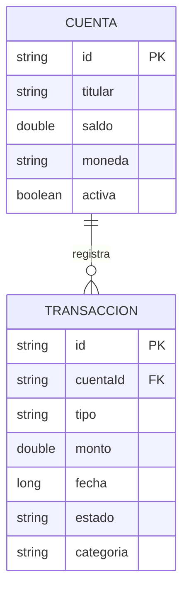

# Módulo 1 — Gestión de Transacciones

## Entidades

### Cuenta

Representa una cuenta bancaria utilizada para procesar transacciones.

| Campo     | Tipo Java | Tipo PostgreSQL    | Descripción                          |
|-----------|-----------|--------------------|--------------------------------------|
| `id`      | `String`  | `VARCHAR(50)`      | Identificador único. Clave primaria. |
| `titular` | `String`  | `VARCHAR(100)`     | Nombre del titular.                  |
| `saldo`   | `double`  | `DOUBLE PRECISION` | Saldo actual.                        |
| `moneda`  | `String`  | `VARCHAR(10)`      | Código de moneda: USD, EUR o ARS.    |
| `activa`  | `boolean` | `BOOLEAN`          | Indica si la cuenta está activa.     |

**Tabla:** `cuentas`.

### Transaccion

Registra movimientos financieros asociados con una cuenta.

| Campo       | Tipo Java | Tipo PostgreSQL    | Descripción                                      |
|-------------|-----------|--------------------|--------------------------------------------------|
| `id`        | `String`  | `VARCHAR(50)`      | Identificador único. Clave primaria.             |
| `cuentaId`  | `String`  | `VARCHAR(50)`      | Cuenta asociada. Clave foránea a `cuentas.id`.   |
| `tipo`      | `String`  | `VARCHAR(20)`      | DEBITO, CREDITO o TRANSFERENCIA.                 |
| `monto`     | `double`  | `DOUBLE PRECISION` | Importe de la transacción.                       |
| `fecha`     | `long`    | `BIGINT`           | Fecha en milisegundos desde Unix epoch.          |
| `estado`    | `String`  | `VARCHAR(20)`      | PENDIENTE, COMPLETADA o RECHAZADA.               |
| `categoria` | `String`  | `VARCHAR(50)`      | COMIDA, TRANSPORTE, SERVICIOS o ENTRETENIMIENTO. |

**Tabla:** `transacciones`.

## Relación entre entidades

Una cuenta puede tener muchas transacciones. Cada transacción referencia una cuenta mediante `cuentaId`.

## Índices previstos

| Tabla           | Índice                        | Columna     |
|-----------------|-------------------------------|-------------|
| `transacciones` | `idx_transacciones_cuenta`    | `cuenta_id` |
| `transacciones` | `idx_transacciones_fecha`     | `fecha`     |
| `transacciones` | `idx_transacciones_categoria` | `categoria` |

## Alcance técnico del módulo

- **Persistencia:** PostgreSQL mediante Spring Data JPA.
- **Ejecución:** secuencial; cada etapa depende de la anterior.
- **Operaciones previstas:** validar cuenta activa, verificar saldo, procesar débito y registrar transacción.
- **Redis:** no se utiliza en este módulo, para conservar una medición base sin caché.
- **Métricas:** tiempo total del procesamiento, duración de consultas y conexiones del pool HikariCP.

> Los campos y valores se basan en el documento del proyecto. Las validaciones de nulidad, precisión
> monetaria, restricciones adicionales y reglas de concurrencia todavía requieren decisiones de diseño.
