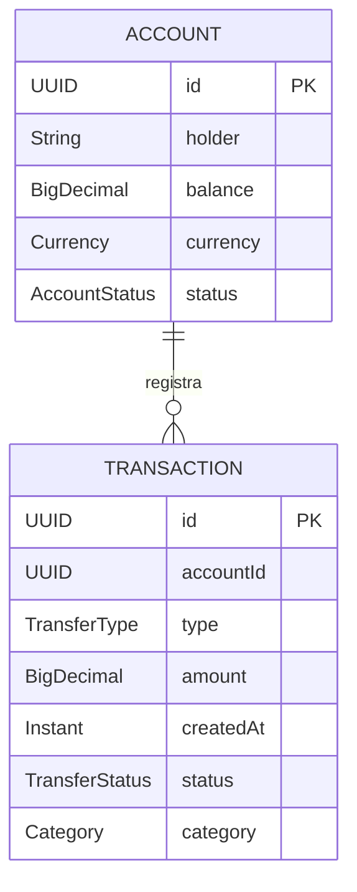

# Módulo 1 — Gestión de Transacciones

## Entidades

### Account

Representa una cuenta utilizada para procesar transacciones financieras.

| Campo      | Tipo Java       | Tipo PostgreSQL | Descripción                                           |
|------------|-----------------|-----------------|-------------------------------------------------------|
| `id`       | `UUID`          | `UUID`          | Identificador único. Clave primaria.                  |
| `holder`   | `String`        | `VARCHAR(255)`  | Nombre del titular.                                   |
| `balance`  | `BigDecimal`    | `NUMERIC(19,2)` | Saldo de la cuenta.                                   |
| `currency` | `Currency`      | `VARCHAR`       | Moneda: `USD`, `EUR` o `ARG`.                         |
| `status`   | `AccountStatus` | `VARCHAR`       | Estado: `ACTIVE`, `INACTIVE`, `SUSPENDED` o `CLOSED`. |

**Tabla:** `accounts`.

Los campos se almacenan con restricciones `NOT NULL`. La moneda y el estado se persisten como texto.

### Transaction

Representa una transacción financiera asociada a una cuenta.

| Campo       | Tipo Java        | Tipo PostgreSQL            | Descripción                                         |
|-------------|------------------|----------------------------|-----------------------------------------------------|
| `id`        | `UUID`           | `UUID`                     | Identificador único. Clave primaria.                |
| `accountId` | `UUID`           | `UUID`                     | Identificador de la cuenta asociada (`account_id`). |
| `type`      | `TransferType`   | `VARCHAR`                  | Tipo: `DEBIT`, `CREDIT` o `TRANSFER`.               |
| `amount`    | `BigDecimal`     | `NUMERIC(19,2)`            | Importe de la transacción.                          |
| `createdAt` | `Instant`        | `TIMESTAMP WITH TIME ZONE` | Momento de creación (`created_at`).                 |
| `status`    | `TransferStatus` | `VARCHAR`                  | Estado: `PENDING`, `COMPLETED` o `FAILED`.          |
| `category`  | `Category`       | `VARCHAR`                  | Categoría de la operación.                          |

**Tabla:** `transactions`.

Los campos se almacenan con restricciones `NOT NULL`. Los valores enum se persisten como texto.

Las categorías disponibles son `FOOD`, `TRANSPORT`, `ENTERTAINMENT`, `UTILITIES`, `HEALTHCARE`,
`EDUCATION`, `SHOPPING`, `TRAVEL` y `OTHER`.

## Relación entre entidades

Una cuenta puede tener múltiples transacciones. `Transaction.accountId` identifica la cuenta asociada.
La asociación se representa mediante UUID en el modelo, sin una relación JPA entre las entidades.

## Índices

| Tabla          | Índice                        | Columna      |
|----------------|-------------------------------|--------------|
| `transactions` | `idx_transactions_account_id` | `account_id` |
| `transactions` | `idx_transactions_created_at` | `created_at` |
| `transactions` | `idx_transactions_category`   | `category`   |

Las claves primarias de `accounts` y `transactions` se indexan mediante PostgreSQL.

## Alcance técnico del módulo

- **Persistencia:** PostgreSQL mediante Spring Data JPA e Hibernate.
- **Procesamiento:** secuencial; cada operación del caso de uso depende de la anterior.
- **Operación del caso de uso:** validar cuenta, verificar saldo, debitar y registrar una transacción.
- **Redis:** no se utiliza en el procesamiento de este módulo.
- **Métricas:** medición de búsquedas y escrituras de persistencia con Micrometer y observación del pool HikariCP.
